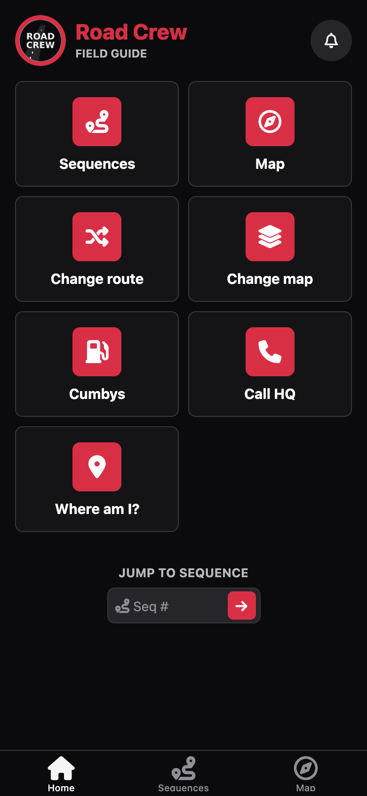
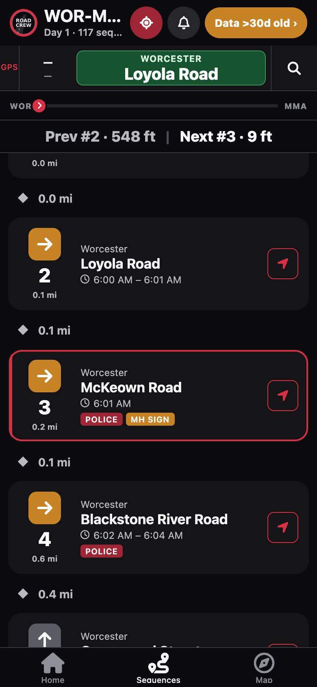
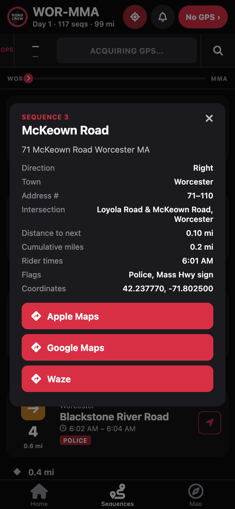
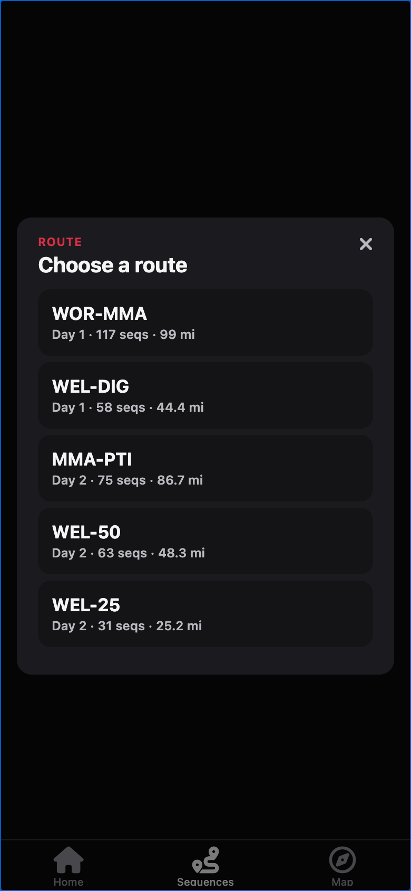
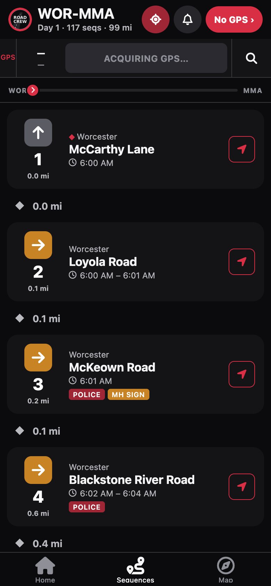
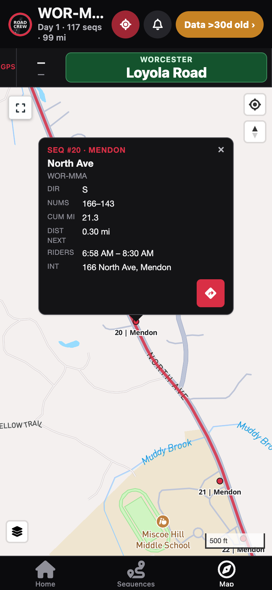
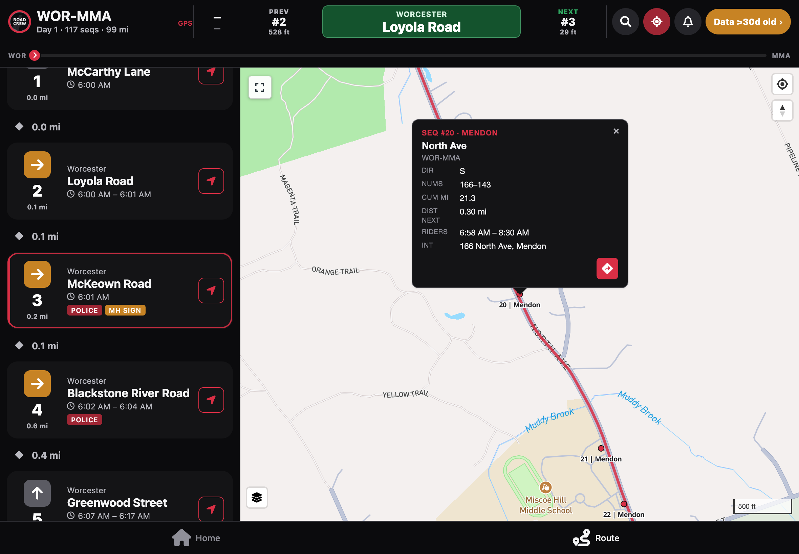

# Road Crew

**A field guide for the volunteers who keep a long-distance charity bike ride on course.**

Road Crew is a phone-first app for the people in vans who drive a cycling
event's routes: marking turns, watching for riders who need help, and
getting to the right corner at the right time. It knows every turn on every
route, follows you with GPS, and works when the cell signal doesn't.

One codebase runs as an installable web app and as native iOS and Android
apps (React Native + Expo).

<p align="center">
  
  &nbsp;
  
  &nbsp;
  
</p>

---

## What it does

A multi-day ride covers hundreds of miles of back roads with thousands of
riders. Road crews used to work from printed cue sheets. This app puts the
whole route in your pocket:

- **Where am I on the route?** GPS snaps you to the route and shows the road
  you're on, the last turn you passed and the next one coming up.
- **What happens at this turn?** Every turn shows its direction, cross-streets,
  the window when riders will pass, and flags like *Police* or *Water stop*.
- **How do I get there?** One tap hands any turn to Apple Maps, Google Maps or
  Waze.
- **What if there's no signal?** Route data ships inside the app, and the web
  version caches itself so it keeps working offline after the first visit.

## Key terms

| Term | Meaning |
| --- | --- |
| **Route** | One day's course from a start to a finish, named by its two ends (for example `WOR-MMA`). The bundled data has five routes across two days. |
| **Sequence** | One numbered turn or checkpoint on a route. A sequence is a GPS point plus the move to make there (left, right, straight) and the road you take until the next one. |
| **Rider times** | When the first and last riders are expected to pass that sequence. |
| **Flags** | Tags on a sequence: *Police*, *Water stop*, *Road crew*, *MH sign* (a state highway sign). |
| **Follow** | The sequence list scrolls itself to keep your current position highlighted as you drive. |
| **Cumbys** | A map layer of nearby gas stations with stores, bundled for offline use. |

## A quick tour

1. **Home** — big tiles for the things you need while driving. Type a number
   into **Jump to sequence** to go straight to that turn on the map.
2. **Choose a route** — pick the day and course you're working.
3. **Sequences** — the turn-by-turn list. With GPS on, the header shows your
   current road and the distance to the previous and next sequence, and the
   list follows along.
4. **Sequence details** — tap any card for the full picture and navigation
   buttons.
5. **Map** — the route line, every sequence marker, nearby gas stations, and
   (in the native apps) other crew vans.

<p align="center">
  
  &nbsp;
  
  &nbsp;
  
</p>

On a tablet or a wide browser window, the **Route** workspace puts the
sequence list and the map side by side, with your position, the previous
sequence and the next one across the top.

<p align="center">
  
</p>

## Web app vs. native app

| | Web app | iOS / Android |
| --- | --- | --- |
| Routes, sequences, GPS follow, navigation links | ✅ | ✅ |
| Works offline after first load | ✅ | ✅ |
| Maps | ✅ (Mapbox token needed) | ✅ (Mapbox token needed) |
| Van tracking, crew-van map, HQ messages | — | ✅ (needs the backend) |

The web app is a self-contained field guide: it runs entirely on the bundled
route data and never calls the backend. The fleet and messaging features exist
only in the native builds.

---

## Run it yourself

You need Node 22 (see [`.nvmrc`](.nvmrc)).

```bash
npm install
cp apps/road-crew/.env.local.example apps/road-crew/.env.local
npm --workspace apps/road-crew start
```

Press `w` in the Expo prompt to open the web app, or `i` / `a` for a simulator.

**Maps need a Mapbox token.** Put a public (`pk.`) token in
`EXPO_PUBLIC_MAPBOX_TOKEN` in `apps/road-crew/.env.local`. It ends up in the
client bundle, so anyone with the app can read it; never use a secret token.
No token is committed here. Without one, everything except the map screens
works. If you add the token after an earlier build, clear Metro's cache once
(`npx expo export --platform web --clear` from `apps/road-crew/`) so the new
value is picked up.

To build and serve the web version the way it's deployed:

```bash
npm run build:web
npm run serve:app
```

Then open <http://localhost:4173>.

### Checks

```bash
npm run lint
npm run test:app
npm run test:packages
npm run test:scripts
npm run test:e2e   # builds the web app, then runs Playwright against it
```

---

## How the code is organized

| Path | Purpose |
| --- | --- |
| [`apps/road-crew/`](apps/road-crew/README.md) | The Expo app for web, iOS and Android. Its README covers GPS, offline, sync and update behavior in depth. |
| [`packages/contracts/`](packages/contracts/) | Shared types for route and sequence data and the backend API |
| [`packages/core/`](packages/core/) | Pure route logic: nearest sequence, path distance, formatting, validation |
| [`packages/data/`](packages/data/) | Loads route data on every platform |
| [`packages/data/routes/`](packages/data/routes/) | The bundled route catalog, sequences and path geometry |
| [`packages/config/`](packages/config/README.md) | Runtime config plus release and build metadata |
| [`packages/ui/`](packages/ui/) | Shared design tokens and theme |
| [`docs/screenshots/`](docs/screenshots/) | Images used in this README |

### Route data

`packages/data/routes/` holds five routes with their full turn-by-turn
sequences, coordinates, rider pass times and path geometry. The app bundles
this data so a fresh install can open routes and sequences before it ever
reaches the network.

Sequence records carry no operational notes. The upstream data had a
per-sequence `remarks` field used for internal crew instructions; it is not
part of this repository's data or its type contracts.

### Backend

The app talks to a backend over the `/api/*` surface described in
[`packages/contracts/src/index.ts`](packages/contracts/src/index.ts) and
[`packages/config/src/index.ts`](packages/config/src/index.ts). That service is
not part of this repository. The hosted web build makes no `/api/*` requests;
it runs from bundled route data plus the unauthenticated `GET /version` check
used for updates. Only native builds use the authenticated surface.

Point a native dev build at your own backend with:

```bash
EXPO_PUBLIC_API_BASE_URL=http://localhost:8787 npm --workspace apps/road-crew start
```

### Versions and releases

Release and build metadata live in
[`packages/config/src/version.ts`](packages/config/src/version.ts). The dynamic
Expo config applies that value to the native app config, and shared runtime
code imports it directly. History is in
[`packages/config/VERSION_HISTORY.md`](packages/config/VERSION_HISTORY.md).
For every app release, update `version.ts` and record the build in the version
history; see [`RELEASE.md`](RELEASE.md). The web export generates
`/js/version.js` from the same metadata.
